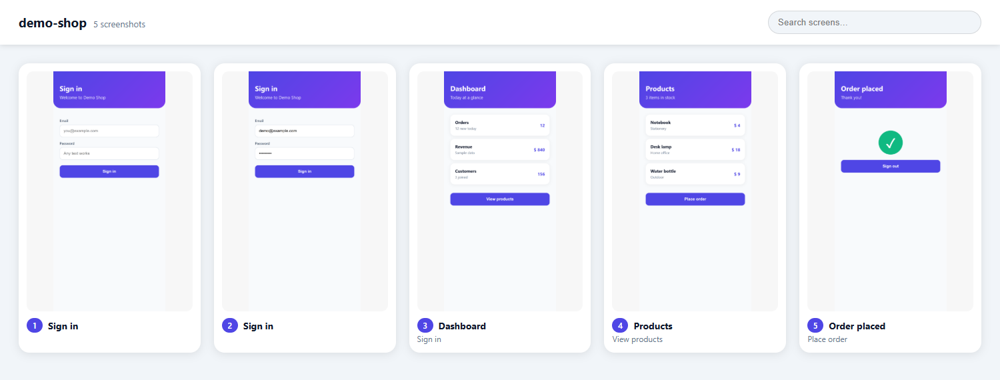

# 📸 Universal Screenshot Capture

**Use a website normally. Get a screenshot of every screen, automatically.**


Making a user manual, a presentation or a bug report usually means pressing the screenshot key again and again. This tool opens your site in Chrome or Edge. You log in and click around as usual, and it saves a sharp image whenever the screen changes. At the end you get a searchable gallery.



**Contents:** [Features](#-features) · [Quick start](#-quick-start) · [বাংলা গাইড](#-বাংলা-গাইড-banglish) · [Settings](#️-settings) · [Output](#-output) · [Privacy](#-privacy-and-security) · [Troubleshooting](#-troubleshooting)

## ✨ Features

- **Automatic capture** of new pages, pop-ups, tabs, menus, scrolling and filled-in forms
- **Sharp images** in mobile, tablet, desktop or custom size, up to 4× resolution
- **Full-page mode** for long web pages
- **Works with embedded frames** from other websites, such as app prototypes
- **Offline gallery** with search and a full-screen viewer
- **Privacy tools:** pause key and blur
- **No dependencies:** nothing to `npm install`

## 🚀 Quick start

**You need:** [Node.js](https://nodejs.org) 20 or newer, and Google Chrome, Microsoft Edge or Chromium.

**1. Get the code.** Click **Code → Download ZIP** and extract it, or clone it:

```bash
git clone https://github.com/Ashikur07/universal-capture.git
cd universal-capture
```

**2. Start it.**

| System | Command |
|---|---|
| Windows | Double-click **`start.bat`** |
| macOS / Linux | `npm start` |

**3. Give it a link.** On the first run a `.env` file is created and you are asked for a website. To save the link, write it in `.env`:

```ini
URL=https://example.com
```

**4. Browse.** Use the website in the window that opens. Stay on each screen for a second or two.

**5. Finish.** Close the browser, or press `Ctrl+C` in the terminal. Then open `gallery.html` in the folder shown at the end.

### ⌨️ Keys

Press these inside the browser window. On many laptops you need to hold `Fn` too.

| Key | Action |
|---|---|
| `F8` | Save the current screen now (also works while paused) |
| `F9` | Pause or resume |

## 🇧🇩 বাংলা গাইড (Banglish)

1. [Node.js](https://nodejs.org) 20 ba tar notun install koro. Chrome ba Edge thakte hobe.
2. **Code → Download ZIP** kore extract koro.
3. Windows-e **`start.bat`** double-click koro. Mac ba Linux-e `npm start` chalao.
4. Website-er link paste kore Enter chapo. Protibar likhte na chaile `.env` file-e `URL=` er pore link boshao.
5. Browser-e login kore ek ek kore page-e jao. Protita screen-e 1-2 second thamo.
6. Kono screen save na hole `F8` chapo. Sensitive kaj korar age `F9` diye pause koro.
7. Sesh hole browser bondho koro, tarpor `gallery.html` kholo.

**Shabdhan:** `.env`-e password ba OTP likhbe na. Chhobi share korar age protita dekhe nio.

## ⚙️ Settings

Change these in `.env`. Each one is also explained in [`.env.example`](.env.example).

| Name | Default | Description |
|---|---|---|
| `URL` | *(ask)* | Website to open: `https`, `http` or `file` |
| `PROJECT_NAME` | website name | Name of the output folder |
| `DEVICE` | `mobile` | `mobile`, `tablet`, `desktop` or `custom` |
| `WIDTH`, `HEIGHT` | from device | Screen size, 200–3840 |
| `SCALE` | from device | Sharpness, 1–4 |
| `CAPTURE_MODE` | `auto` | `auto`, or `manual` to save only on `F8` |
| `FULL_PAGE` | `false` | Capture the whole scrollable page (up to 12,000 px tall) |
| `WAIT_MS` | `1000` | How long a screen must stay still before saving, 300–10000 |
| `BLUR` | *(off)* | CSS selector of things to blur, for example `.balance, #phone` |
| `KEEP_LOGIN` | `false` | Stay logged in for next time |
| `OUTPUT_DIR` | `screenshots` | Where images are saved |
| `BROWSER_PATH` | *(auto)* | Browser program, if it is not found automatically |

| Device | Size | Image width |
|---|---|---|
| `mobile` | 420 × 900 | 1260 px |
| `tablet` | 820 × 1180 | 1640 px |
| `desktop` | 1440 × 900 | 2880 px |

### Command line

```text
node src/cli.js [url] [options]

-e, --env <file>      settings file to use (default: .env)
-d, --device <name>   mobile | tablet | desktop | custom
-m, --manual          save only when you press F8
-f, --full-page       capture the whole scrollable page
-h, --help            show help
-v, --version         show the version
```

```bash
node src/cli.js https://example.com --device desktop --full-page
```

**Several websites?** Keep one file for each in the project folder, such as `shop.env` or `admin.env`, and choose one with `--env shop.env`.

## 📁 Output

```text
screenshots/
└── example.com/
    └── 2026-01-31-14-05-09/
        ├── 001_Sign-in.png
        ├── 002_Dashboard.png
        ├── gallery.html     ← open this
        └── screens.json
```

`screens.json` lists each image with its title, page address, the clicks made before it, and the positions of headings, buttons and fields. This is handy for building guides or slides. Positions are in CSS pixels; multiply by `view.scale` to get image pixels.

## 🔒 Privacy and security

Please read this before sharing screenshots.

- **Images show whatever is on screen:** names, numbers, balances, messages, and passwords if you reveal them. Check every image.
- **`screens.json` and the gallery contain page text** such as titles, headings, buttons and addresses. Some may be personal. Typed values, query strings and `#` fragments are not saved. A private ID inside the address path is saved.
- **`BLUR` is best effort.** It does not reach inside shadow DOM, and content may show briefly while a page loads. An invalid selector stops the run, but a valid selector that matches nothing blurs nothing.
- **Pause with `F9`** before doing anything sensitive.
- **Never write passwords or OTPs in `.env`.** Type them in the browser.
- **`KEEP_LOGIN=true` stores your login** in the `profiles/` folder. Never share it. Delete it to log out.
- With `KEEP_LOGIN=false`, the temporary browser profile is deleted when the run ends. If the program is force-killed or the PC loses power, delete leftover `ucapture-*` folders in your system temp folder.
- The browser is controlled through a **private pipe**, not a network debugging port.
- `.env`, `screenshots/` and `profiles/` are in `.gitignore`. If you change `OUTPUT_DIR` to another folder inside the project, add it there too. Uploading files by hand on the GitHub website ignores `.gitignore`.
- The tool uploads nothing and has no analytics. The browser itself behaves like a normal Chrome or Edge.

**Capture only websites you own or have permission to capture,** and follow their terms.

## 🛠 Troubleshooting

| Problem | What to do |
|---|---|
| Nothing is saved | Press `F8`. Changes drawn only on a `<canvas>` (some games and Flutter web apps) may not be noticed |
| Too many screenshots | Set `WAIT_MS=2000`, or `CAPTURE_MODE=manual` |
| A screen was missed | Stay on it longer, or press `F8`. Very short messages can disappear before they are saved |
| Browser not found | Set `BROWSER_PATH` |
| Browser does not start with `KEEP_LOGIN=true` | Close the other capture window for the same project |
| A site will not let you log in | Some sites and sign-in providers may block automated browsers. This tool does not try to get around that |
| `FULL_PAGE` misses part of an app | It covers the main page only, not scroll areas inside it. Scroll and pause instead |

## 🧠 How it works

The tool talks to the browser through the Chrome DevTools Protocol and checks the screen about three times a second. When something changes and then stays still for `WAIT_MS`, it saves an image. It compares page text, images, form state, open menus and scroll position instead of pixels, so a blinking cursor or a ticking clock does not create endless screenshots.

Developed and tested on Windows 11. macOS and Linux support is included but not yet tested. Bug reports are welcome in Issues; please remove private data and screenshots first.

## 📄 License

[MIT](LICENSE)
